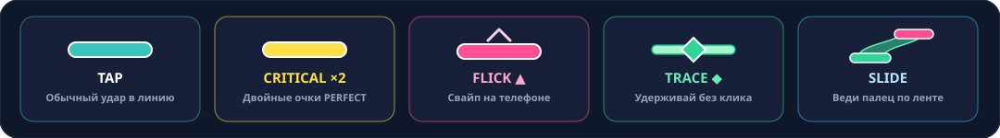
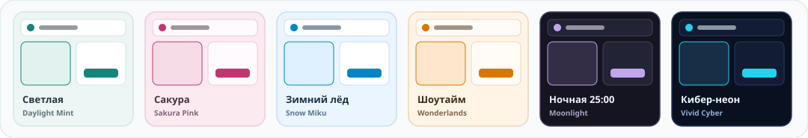
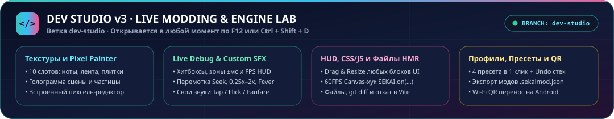

 

<h3>Ритм-игра на 4 дорожки в стиле Project SEKAI для собственной музыки на ПК и Android</h3>

  
  
  
  
  

  <a href="#-быстрый-старт">Быстрый старт</a> ·
  <a href="#-возможности">Возможности</a> ·
  <a href="#-типы-нот">Типы нот</a> ·
  <a href="#-темы-оформления">Темы оформления</a> ·
  <a href="#-dev-studio-ветка-dev-studio">Dev Studio</a> ·
  <a href="#-архитектура-проекта">Архитектура</a>

---

## ✨ Возможности

<table>
  <tr>
    <td width="50%" valign="top">
      <h3>🎵 Умный аудио-анализатор v4</h3>
      <ul>
        <li>Загружай любые треки (<code>MP3</code>, <code>WAV</code>, <code>OGG</code>, <code>FLAC</code>, <code>M4A</code>).</li>
        <li>Автоматический расчёт <strong>BPM</strong>, первого удара (<code>Offset</code>) и лучшего припева для превью.</li>
        <li>Мгновенная генерация <strong>6 сложностей</strong> (<code>EASY → APPEND</code>), включая 6-дорожечные 16-е серии и широкие акценты.</li>
      </ul>
    </td>
    <td width="50%" valign="top">
      <h3>🎮 3D-сцена, 2DMV и Ghost Replay</h3>
      <ul>
        <li>Плавный 3D-тракт с <strong>2DMV-видео/артом</strong>, пульсирующими лайтстиками зала и эффектами <code>FEVER / SUPER FEVER</code>.</li>
        <li><strong>Ghost Replay</strong> — живое сравнение счёта с личным рекордом (<code>BEST ±счёт</code>).</li>
        <li><strong>Soflan</strong> (смена скорости скролла посреди песни) и интерактивный график точности <em>Early / Late</em>.</li>
      </ul>
    </td>
  </tr>
  <tr>
    <td width="50%" valign="top">
      <h3>✏️ Встроенный редактор чартов</h3>
      <ul>
        <li>Расстановка <code>Tap</code>, <code>Critical</code>, <code>Flick</code>, <code>Trace</code>, изогнутых <code>Slide</code> и точек <strong>Soflan</strong> прямо по волновой форме аудио.</li>
        <li>Привязка к сетке долей (<code>1/4 → 1/32</code>), тест-плей с любой секунды и авторегулировка темпа.</li>
        <li>Импорт и экспорт популярных форматов <strong><code>.usc</code></strong>, <strong><code>.sus</code></strong> и <code>.json</code>.</li>
      </ul>
    </td>
    <td width="50%" valign="top">
      <h3>💎 Команда, миссии и бэкапы</h3>
      <ul>
        <li>Команда из <strong>5 карт</strong> (<em>Score Up</em>, <em>Perfect Lock</em>, <em>Healer</em>) с выплывающими cut-in на сцене.</li>
        <li>Система кристаллов, <strong>миссий</strong>, титулов и коллекционных рамок профиля.</li>
        <li>Обмен песнями (<code>.sekaisong</code>), сборниками (<code>.sekaipack</code>), полным профилем (<code>.sekaibackup</code>) и по <strong>Wi-Fi QR</strong>.</li>
      </ul>
    </td>
  </tr>
</table>

---

## 🚀 Быстрый старт

| Платформа | Как запустить | Управление |
| :--- | :--- | :--- |
| 💻 **ПК (без установки)** | Открой **`index.html`** двойным кликом в браузере *(или распакуй `SEKAI-Custom-Stage-PC.zip`)* | Дорожки: <kbd>D</kbd> <kbd>F</kbd> <kbd>J</kbd> <kbd>K</kbd> или <kbd>←</kbd> <kbd>↓</kbd> <kbd>↑</kbd> <kbd>→</kbd> Пауза: <kbd>Esc</kbd> · Рестарт: <kbd>R</kbd> |
| 📱 **Android** | Установи **`SEKAI-Custom-Stage.apk`** (`1.3 МБ`) на смартфон | Мультитач и свайпы (`Flick`) по 4 плиткам + тактильный отклик |
| 🛠️ **Режим разработки** | `cd sekai-custom-stage && npm install && npm run dev` | Открывает HMR-сервер `:5173` и доступ к файлам из Dev Studio |

> **Совет:** Для автономного режима разработчика на ПК без Node.js открой **`SEKAI-Custom-Stage-DevStudio.html`** и нажми <kbd>F12</kbd> или <kbd>Ctrl</kbd>+<kbd>Shift</kbd>+<kbd>D</kbd>.

---

## 🎼 Типы нот

  

---

## 🎨 Темы оформления

В настройках доступно **6 полноценных тем** (плюс автопереключение под жанр/тег песни) и живой анимированный фон:

  

---

## 🛠️ Dev Studio (ветка `dev-studio`)

В отдельную ветку **`dev-studio`** вынесена полноценная встроенная студия для моддинга, отладки геймплея и редактирования исходников в реальном времени:

  

| Ветка / Сборка | Назначение |
| :--- | :--- |
| **`main`** (`index.html`, `SEKAI-Custom-Stage.apk`) | Чистая, лёгкая релизная версия для игры без отладочных панелей |
| **`dev-studio`** (`SEKAI-Custom-Stage-DevStudio.html`) | Расширенная версия с Dev Studio v3: Live Debug, Custom SFX, Pixel Painter, 60FPS JS/CSS-хуки, пресеты, профили, Undo, `git diff` и Wi-Fi QR |

---

## 📁 Архитектура проекта

<strong>Развернуть структуру файлов и модулей (кликни, чтобы посмотреть)</strong>

### Готовые сборки в корне
| Файл / папка | Назначение |
| :--- | :--- |
| `index.html` | Автономная релизная версия для ПК — весь билд вшит в один HTML-файл |
| `SEKAI-Custom-Stage-DevStudio.html` | Автономная сборка с панелью **DEV STUDIO v3** (`F12` / `Ctrl+Shift+D`) |
| `SEKAI-Custom-Stage-PC.zip` | Архив ПК-версии с автономным `index.html`, PWA и скриптами запуска (`.bat` / `.sh`) |
| `SEKAI-Custom-Stage.apk` | Подписанный установочный APK для Android |
| `release/` | Разделённые релизные папки `android/` (APK + ключ подписи) и `pc-web/` |
| `docs/` | Векторные SVG-баннеры и иллюстрации для `README.md` |

### Исходный код (`sekai-custom-stage/`)
| Файл / папка | За что отвечает |
| :--- | :--- |
| `src/App.tsx` | Главный экран, выбор песен, темы, команда, миссии, профили и QR-импорт |
| `src/components/GameCanvas.tsx` | 3D-движок геймплея: ноты, 2DMV, Soflan, Ghost Replay, Live Debug и HUD |
| `src/components/ChartEditor.tsx` | Визуальный редактор чартов с волновой формой, Soflan и тест-плеем |
| `src/components/ResultsScreen.tsx` | Экран итогов с интерактивным графиком смещения `Early / Late` |
| `src/components/SettingsModal.tsx` | Настройки клавиш (включая стрелки), скорости, калибровки, тем и бэкапов |
| `src/dev/` | Модуль **DEV STUDIO** (`DevStudioDrawer`, `devStudioStore`, `PixelTexturePainter`, `modPresets`, `qrSvg`) |
| `src/audio/` | Авто-анализатор BPM (`analyzer.ts`), Web Audio + кастомные SFX (`soundEngine.ts`), `.usc` / `.sus` |
| `src/storage/db.ts` | Хранение песен, аудио и клипов в IndexedDB + `.sekaisong` / `.sekaipack` / `.sekaibackup` |
| `src/theme/` | Палитры, CSS-токены и стили 6 тем оформления |
| `src/utils/` | Нормализация клавиш (`keys.ts`), санитайзер слайдов (`chartSanitizer.ts`) и хаптики (`haptics.ts`) |
| `android/` | Нативный проект Android (Capacitor 5 + Gradle) |
| `vite.config.ts` / `vite.standalone.config.ts` | Dev-сервер с API `/__dev/*` + LAN QR и сборщик однофайлового HTML |

