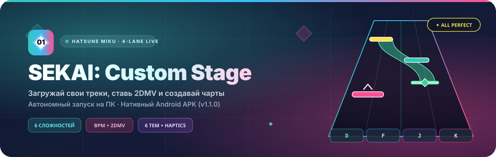

 
 

  
  
  
  

---

## 🎯 Для чего этот проект

**SEKAI: Custom Stage** — ритм-игра на 4 дорожки в стиле _Project SEKAI_ для игры под **собственную музыку** на ПК и Android.

- Загружай любые треки (`MP3`, `WAV`, `OGG`, `FLAC`, `M4A`) — игра сама определит **BPM**, припев и создаст 6 сложностей (`EASY → APPEND`).
- Ставь видеоклипы (**2DMV**) и обложки, редактируй ноты в встроенном редакторе или импортируй `.usc` / `.sus`.
- Выбирай одну из **6 тем оформления**, собирай команду из 5 карт, открывай миссии и переноси библиотеку между ПК и телефоном.

---

## 🚀 Как запустить

| Платформа | Как запустить | Управление |
| :--- | :--- | :--- |
| 💻 **ПК (без установки)** | Открой **`index.html`** двойным кликом в любом браузере *(или распакуй `SEKAI-Custom-Stage-PC.zip`)* | Дорожки: <kbd>D</kbd> <kbd>F</kbd> <kbd>J</kbd> <kbd>K</kbd> Пауза: <kbd>Esc</kbd> · Рестарт: <kbd>R</kbd> |
| 📱 **Android** | Установи **`SEKAI-Custom-Stage.apk`** (`1.3 МБ`) на телефон | Мультитач и свайпы (`Flick`) по 4 плиткам |
| 🛠️ **Режим разработки** | `cd sekai-custom-stage && npm install && npm run dev` | — |

---

## 📁 За что отвечают файлы

### Готовые сборки в корне
| Файл / папка | Назначение |
| :--- | :--- |
| `index.html` | Автономная версия для ПК — всё вшито в один файл, открывается прямо в браузере |
| `SEKAI-Custom-Stage-PC.zip` | Архив ПК-версии с автономным `index.html`, PWA и скриптами запуска (`.bat` / `.sh`) |
| `SEKAI-Custom-Stage.apk` | Готовый подписанный установочный файл для Android |
| `release/` | Разделённые релизные папки `android/` (APK + ключ подписи) и `pc-web/` |
| `docs/` | SVG-баннеры и иллюстрации для оформления `README.md` |

### Исходный код (`sekai-custom-stage/`)
| Файл / папка | За что отвечает |
| :--- | :--- |
| `src/App.tsx` | Главный экран, выбор песен, темы, команды, миссии и навигация |
| `src/components/GameCanvas.tsx` | 3D-движок геймплея: ноты (`Tap`, `Critical`, `Flick`, `Trace`, `Slide`), HUD, 2DMV и пауза |
| `src/components/ChartEditor.tsx` | Визуальный редактор чартов с сеткой долей и тестом с любого места |
| `src/components/SettingsModal.tsx` | Настройки клавиш, скорости, калибровки, тем, памяти и экспорта бэкапов |
| `src/components/AnimatedBackdrop.tsx` | Живой анимированный фон приложения |
| `src/audio/` | Авто-анализатор BPM (`v4`), Web Audio движок и импорт `.usc` / `.sus` |
| `src/storage/db.ts` | Локальное хранение песен, аудио и клипов в IndexedDB + `.sekaisong` / `.sekaipack` / `.sekaibackup` |
| `src/theme/` | Палитры и стили 6 тем оформления |
| `src/utils/haptics.ts` | Тактильная вибрация на Android (`@capacitor/haptics`) и Web |
| `android/` | Нативный проект Android (Capacitor 5 + Gradle) |
| `vite.config.ts` / `vite.standalone.config.ts` | Сборка обычной PWA/Android-версии и однофайлового `index.html` для ПК |
